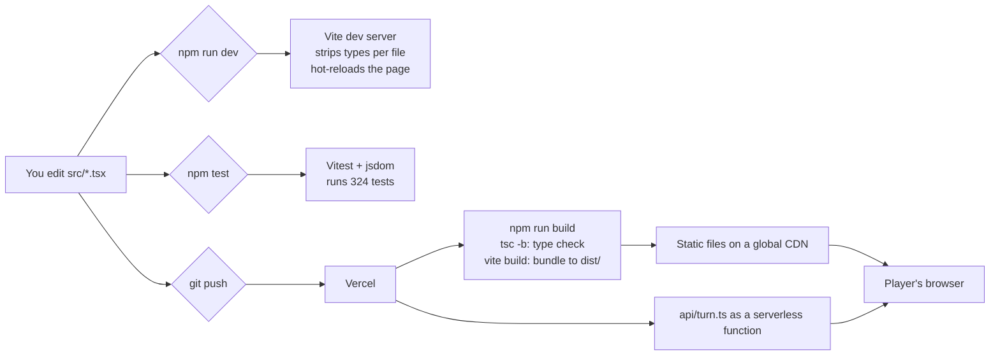

# 4. The toolchain: npm, Vite, Vitest, oxlint and Vercel

**Goal:** explain everything that happens between you saving a file and a player loading the game on their phone.



## 4.1 npm and package.json

[package.json](../../package.json) describes the project:

```json
"type": "module",                        // .js files use import/export (ES modules)
"scripts": { "dev": "vite", ... },       // commands for npm run
"dependencies": { "react": "^19.3.1", "zustand": "^5.1.0", "peerjs": "^1.5.5", ... },
"devDependencies": { "vite": "^8.3.6", "vitest": "^5.1.0", "typescript": "~7.0.2", ... }
```

- **dependencies** end up in the code players download. There are only four, which keeps the site small.
- **devDependencies** are tools used while building and testing. Players never download them.
- **Version ranges:** `^19.3.1` allows any 19.x.y at or above 19.3.1 (minor and patch updates); `~7.0.2` allows only 7.0.x (patch updates). TypeScript is pinned tighter because even minor versions can add new type errors.
- **[package-lock.json](../../package-lock.json)** records the exact version of every package (and their dependencies) that was installed. Commit it, so every machine and Vercel install exactly the same thing. `npm ci` installs strictly from the lockfile, which is what CI servers use.

## 4.2 Why a build tool at all?

Browsers run JavaScript, not TypeScript or JSX. And a real app is hundreds of files that import each other, plus libraries in `node_modules/` that the browser can't find on its own. A build tool:

1. turns `.ts`/`.tsx` into `.js` (removing types, turning JSX into function calls);
2. resolves `import 'react'` to the right file in `node_modules/`;
3. in production, **bundles** many files into a few, **minifies** them (removes spaces, shortens names), and gives each file a **content hash** in its name so browsers can cache them forever.

## 4.3 Vite

[Vite](https://vite.dev/) does two different jobs:

**In development (`npm run dev`)** it doesn't bundle at all. The browser asks for `/src/main.tsx`; Vite strips the types from just that file and sends it. The browser then sees `import App from './App.tsx'`, asks for that, and so on. Only the files you use get processed, one at a time, which is why the dev server starts instantly. When you save a file, Vite pushes the change to the open page over a WebSocket and React swaps in the new component without losing state. That's **hot module replacement** (HMR).

**In production (`vite build`)** it bundles properly. Here is this project's real output:

```
dist/index.html                        0.45 kB │ gzip:   0.29 kB
dist/assets/index-DVkX2LU9.css        29.57 kB │ gzip:   7.21 kB
dist/assets/index-BSVg9UjN.js        351.86 kB │ gzip: 110.93 kB   ← the game
dist/assets/bundler-B4tojH6p.js      114.62 kB │ gzip:  30.57 kB   ← PeerJS, loaded only for online play
dist/assets/peerNetwork-Dw7UVj0y.js    2.35 kB │ gzip:   1.21 kB   ← the WebRTC adapter, likewise
```

The last two files exist because the code uses **dynamic imports** (`import('peerjs')`, `import('../net/peerNetwork')`). Vite splits each into its own **chunk**, so a player who only plays locally never downloads the networking code. That's **code splitting**.

### Reading vite.config.ts

[vite.config.ts](../../vite.config.ts) does three things:

1. `react()` adds JSX support and React-aware hot reload.
2. `turnApi(...)` is a small custom **plugin**: during `dev` and `preview` it answers `GET /api/turn` using the same function that Vercel runs in production (`iceServersFromEnv` from [api/turn.ts](../../api/turn.ts)). So online play works locally without any extra tool. This is **dev/prod parity**: the same code path in both places.
3. `test: { ... }` configures Vitest (next section).

### Environment variables, and keeping secrets secret

Vite exposes environment variables that start with `VITE_` to browser code (as `import.meta.env.VITE_…`), which means **anyone can read them** in the downloaded JavaScript. This project's TURN secrets are deliberately named `TURN_…`, so Vite never puts them in the bundle. Only the server-side function reads them. `loadEnv(mode, process.cwd(), 'TURN_')` in the config reads them for the dev server only.

## 4.4 TypeScript's role in the build

`tsc -b` ("build mode") type-checks the projects listed in [tsconfig.json](../../tsconfig.json): `tsconfig.app.json` (the browser code in `src/`, with DOM types) and `tsconfig.node.json` (the config and `api/`, with Node types). They're separate because browser code shouldn't be able to use Node's `process` or `fs`, and Node code has no `window`. `noEmit: true` means `tsc` only checks; Vite produces the JavaScript.

## 4.5 Vitest and jsdom

[Vitest](https://vitest.dev/) is the test runner. It reuses Vite's transform pipeline, so tests understand TypeScript and JSX with no extra setup, and it's fast. The config in `vite.config.ts`:

```ts
test: {
  environment: 'jsdom',                       // fake browser: document, window, localStorage
  globals: false,                             // import describe/it/expect explicitly
  setupFiles: ['./src/__tests__/setup.ts'],   // runs before every test file
  include: ['src/**/*.test.{ts,tsx}', 'api/**/*.test.ts'],
}
```

**jsdom** is a pretend browser written in JavaScript. It has a DOM, events and `localStorage`, but no real layout, painting or audio. That's why sound is mocked in UI tests. [setup.ts](../../src/__tests__/setup.ts) adds matchers like `toBeInTheDocument()` and unmounts components after each test.

Tests live **next to the code they test** (`engine.ts` and `engine.test.ts` side by side). Chapter 10 covers testing in depth.

## 4.6 oxlint

A **linter** reads code and flags likely mistakes that are still valid code. [oxlint](https://oxc.rs/) is a linter written in Rust, many times faster than ESLint, with most of the same rules. [.oxlintrc.json](../../.oxlintrc.json) turns on the React, TypeScript and oxc plugins, and makes two rules explicit:

- `react/rules-of-hooks`: **error**. Calling a hook inside an `if` breaks React (chapter 3).
- `react/only-export-components`: **warn**. Files that export components should only export components, or hot reload can't swap them safely.

## 4.7 Vercel: hosting and the one serverless function

[Vercel](https://vercel.com/) hosts the live site. There's no `vercel.json` in the repo because Vercel recognises a Vite project on its own:

1. On each deployment Vercel runs `npm install` and `npm run build`.
2. It serves the `dist/` folder from its **CDN** (servers around the world, so files load from somewhere near the player).
3. Every file in the `api/` folder becomes a **serverless function**: code that runs on demand when a request arrives, with no server for you to manage. [api/turn.ts](../../api/turn.ts) exports `GET()`, so `GET /api/turn` runs it.
4. [.vercelignore](../../.vercelignore) excludes `api/**/*.test.ts`, so the test file next to the function isn't deployed as an endpoint.
5. **Environment variables** (the TURN credentials) are set in the Vercel dashboard (Project → Settings → Environment Variables), never in the repo.
6. When a project is connected to its GitHub repository, every push to `main` deploys to production, and pushes to other branches get their own **preview URL**. That lets you try a change on a real phone before merging it.

**Why does this game need a server function at all?** The TURN relay provider gives out an API key. If that key were in the browser code, anyone could copy it and use up the free allowance. The function keeps the key on the server and hands out short-lived relay credentials instead. Everything else is static files. Chapter 9 explains TURN.

**Why Vercel and not something else?** It's free for hobby projects, deploys from Git with no configuration, and runs `api/` functions alongside static files. Netlify or Cloudflare Pages would work too. A plain static host (such as GitHub Pages) would serve the game but couldn't run the function. ([LEARNINGS.md §7](../../LEARNINGS.md#7-hosting-online-play-for-free) covers hosting costs in detail.)

## 4.8 What a player's browser actually does

1. Requests `https://star-hop-game.vercel.app/` → gets `index.html` (tiny).
2. `index.html` loads `assets/index-….css` and `assets/index-….js`.
3. The JS runs `main.tsx`'s code: React mounts `<App/>` into `<div id="root">`.
4. The game store reads any saved game from `localStorage`.
5. Only if the player goes online: the browser downloads the PeerJS chunk and calls `/api/turn`.

Hashed filenames mean step 2 hits the browser's cache on later visits; a new deployment produces new hashes, so nobody gets a stale mix of old and new files.

## Try it

1. Run `npm run build` and look inside `dist/`. Open `dist/assets/index-*.js` and search for `Star Hop needs` (an error message from `createGame`). That's your code, minified.
2. Run `npm run preview`, open the URL, and in DevTools → Network reload the page. Confirm the PeerJS chunk is *not* loaded. Start creating an online game and watch it load.
3. In DevTools → Network, find the request to `/api/turn` during online setup. What does it return without a `.env.local`?

## Check yourself

1. What's the difference between `dependencies` and `devDependencies`?
2. Why does `npm run dev` start instantly while `npm run build` takes a moment?
3. Why are the TURN variables not prefixed with `VITE_`?
4. What is code splitting, and which code in this project is split out?
5. What does Vercel do with the `api/` folder?
