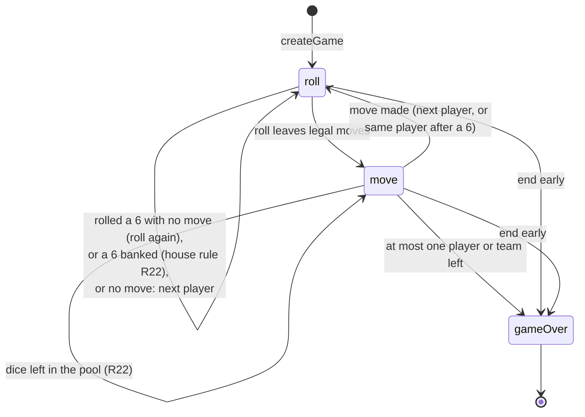
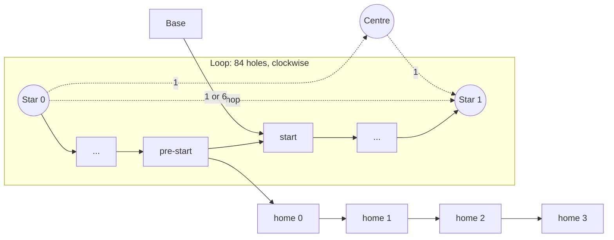

# 5. Game development basics

**Goal:** see a game the way its code sees it, and learn the handful of patterns that make this one simple to test and extend.

You don't need a game engine (Unity, Godot, Phaser) for a board game. A board game is a web app with unusually strict rules, and the patterns below are standard game development ideas applied with plain TypeScript and React.

## 5.1 A game is state + rules + a loop

| Part | In general | In Star Hop |
| --- | --- | --- |
| **State** | Everything you'd need to write down to pause and resume the game | `GameState` in [types.ts](../../src/game/types.ts): players, marbles' spots, whose turn, the phase, the dice |
| **Rules** | Which changes to the state are allowed, and what they cause | [rules.ts](../../src/game/rules.ts) (legal moves) and [engine.ts](../../src/game/engine.ts) (turns, bumps, finishing) |
| **Loop** | Something that keeps the game moving: reads input, applies rules, draws the result | [useStarHopGame.ts](../../src/hooks/useStarHopGame.ts): waits for a click or a bot's decision, animates it, records it |
| **View** | Drawing the state | [Board.tsx](../../src/components/Board.tsx) and friends, using [layout.ts](../../src/game/layout.ts) for positions |

## 5.2 Turn-based versus real-time

An action game runs a **real-time loop**: about 60 times a second it reads input, moves everything a little (physics), and redraws (usually with `requestAnimationFrame` and a `<canvas>`). The state changes continuously.

A board game is **turn-based**: nothing happens until someone acts. So there's no 60 fps loop. Instead the "loop" is event-driven: a click or a timer causes one action, the state jumps to the next position, and the screen animates the change. That's much simpler, and it's why React (which redraws when data changes) is a good fit.

## 5.3 The state machine

At any moment the game is in exactly one **phase**, and each phase allows only certain actions:



In code: `phase: 'roll' | 'move' | 'gameOver'`. `rollWithValue` starts with `if (state.phase !== 'roll' ...) return state` and `applyMove` with `if (state.phase !== 'move') return state`. An action in the wrong phase does nothing. Thinking in states and transitions is the single most useful habit for game code (and for complex UI in general: forms, wizards, checkout flows).

## 5.4 Separate the model from the view

The rules describe the board as **numbers**: loop holes 0 to 83, home slots 0 to 3, a centre ([board.ts](../../src/game/board.ts)). Where each hole is drawn on screen is a completely separate file ([layout.ts](../../src/game/layout.ts)) that turns a `Spot` into an `{x, y}` point.

Because of that split:

- each device can rotate the board so its own player is at the bottom (the `bottom` prop), and the rules never notice;
- the rules can be tested without drawing anything;
- the visual design can change completely without touching a rule.

## 5.5 The board is a graph

A **graph** is a set of places (nodes) and connections between them (edges). Most race games (Ludo, snakes and ladders) are a straight line. Star Hop's board is a graph:



Moving a marble means **searching** this graph: "every place I can reach in exactly N steps without passing my own marbles". [rules.ts](../../src/game/rules.ts) does that, and its result is not just a destination but the whole **path**. The path then feeds the animation (walk it hole by hole), the preview (draw it), the blocking check, the screen-reader label and the bots.

## 5.6 Animation is playback, not truth

A move is fully decided before anything moves on screen: the rules have already listed it, with its whole path. The screen then **plays it back**: the die tumbles for 600 ms, or the marble walks its path one hole every 140 ms. When the playback ends, the action is recorded and the true state jumps to the new position in one step.

The controller keeps two versions of the board:

- `game`: the true state, in the store;
- `shownPlayers`: what's drawn right now, which moves hole by hole during playback.

```
time →    pick marble   +140     +140     +140     +140
game:     before ─────────────────────────────────── after (action recorded)
shown:    before ────── hole 1 ── hole 2 ── hole 3 ── after
```

The principle: **the animation never decides anything**. It only shows what the rules already said. If you skip or speed up every animation (the tests do, with fake timers), the game is identical. Chapter 8 walks through the code (`animate`, `record`, `settle`).

A **busy lock** (`busy` / `busyRef`) stops a second action starting while one is still playing.

All the timings are named constants in one place (`TIMING` in [useStarHopGame.ts](../../src/hooks/useStarHopGame.ts)). Tuning those numbers is how a game's **feel** gets adjusted.

## 5.7 Randomness you can control

Dice are random, but tests need to be repeatable. Three techniques work together:

1. **Inject the random source.** Functions take an `rng: () => number` parameter instead of calling `Math.random()` directly. The real game passes `secureRandom` (the browser's cryptographic generator: fair and unpredictable). Tests pass something predictable.
2. **Seeded generators.** [testUtils.ts](../../src/game/testUtils.ts) has `seeded(42)`, a tiny pseudo-random generator that produces the same "random" sequence for the same seed. Simulations of thousands of bot games use it, so any failure can be replayed exactly.
3. **Record outcomes, not the act of rolling.** A roll action stores its value: `{ type: 'roll', value: 5, actor: 'human' }`. Replaying the action list never rolls again; it reuses the 5. This is what makes undo, saved games and online play exact.

## 5.8 Event sourcing: a game is its history

Instead of storing "the current board", store **the starting position plus every action taken**:

```
initial state  +  [roll 6, move marble 0 to start, roll 3, move marble 0 to 10, ...]  =  current state
```

The current state is computed by applying each action in turn (`replay` in [history.ts](../../src/game/history.ts)). This pattern is called **event sourcing**, and it pays off everywhere:

| Feature | How event sourcing gives it |
| --- | --- |
| Undo | Drop the last actions and replay the rest |
| Redo | Put them back |
| Saved games | Save the initial state and the action list (small JSON) |
| Online play | Send each new action to every guest; they apply it with the same rules |
| Game log | Each action produces **events** ("Red rolled 6", "Blue was bumped"), turned into text |
| Debugging | A bug report is a list of actions you can replay in a test |

## 5.9 Events: what just happened

Each action produces a list of **events** (`GameEvent` in [types.ts](../../src/game/types.ts)): `roll`, `move`, `bump`, `finish`, `noMoves`, `gameOver`… The state says *where things are*; events say *what just happened*. Everything that reacts to a change reads events: sounds (`playOutcomeSounds`), the log and screen-reader announcements ([describe.ts](../../src/game/describe.ts)), the finish banner. The rules themselves don't play sounds or show banners; they just report.

## 5.10 Bots: utility scoring

The computer players in [bot.ts](../../src/game/bot.ts) use a classic, simple game AI technique called **utility scoring**:

1. List every legal move (the same move generator humans use).
2. Give each move a score: points for getting home, for bumping an opponent, for progress, minus points for ending somewhere an opponent could bump you next turn.
3. Add a little random noise so the bot isn't perfectly predictable.
4. Play the highest score.

Different **weights** make different **personas**: a "hunter" values bumps highly, a "guardian" fears danger. With the "roll all your sixes first" house rule, bots also look a couple of dice ahead (a small **beam search**). The [advanced chapter 7](../07-bots-and-probability.md) covers the probability maths.

## 5.11 Invariants and simulations

An **invariant** is something that must always be true: every player has 4 marbles; no two marbles share a hole (except the one allowed case); finished players have all marbles home; the legal moves listed in the state really are the legal moves.

[simulation.test.ts](../../src/game/simulation.test.ts) plays complete seeded bot games and checks every invariant after **every action**. It catches whole categories of bugs that no hand-written example would think of, including games that never end (star hops can circle forever). Games are great for this kind of testing because the rules are precise.

## 5.12 SVG for the board

The board is drawn with **SVG** (vector graphics made of elements like `<circle>` and `<path>`), not a `<canvas>` (a bitmap you paint with code). For about 300 shapes that change only on each move, SVG wins: every hole is a real element, so clicks, keyboard focus, screen-reader labels and CSS theming all work for free, and it scales sharply to any screen size via a `viewBox`. Canvas wins for thousands of objects redrawn every frame. ([Advanced chapter 2](../02-svg-and-geometry.md).)

## Check yourself

1. Name the three phases and which action each one accepts.
2. Why does the board on screen lag behind the real game state, and why is that safe?
3. How can a test make dice predictable without changing any game code?
4. List four features that event sourcing gives this game.
5. What's an invariant? Give two from this game.
