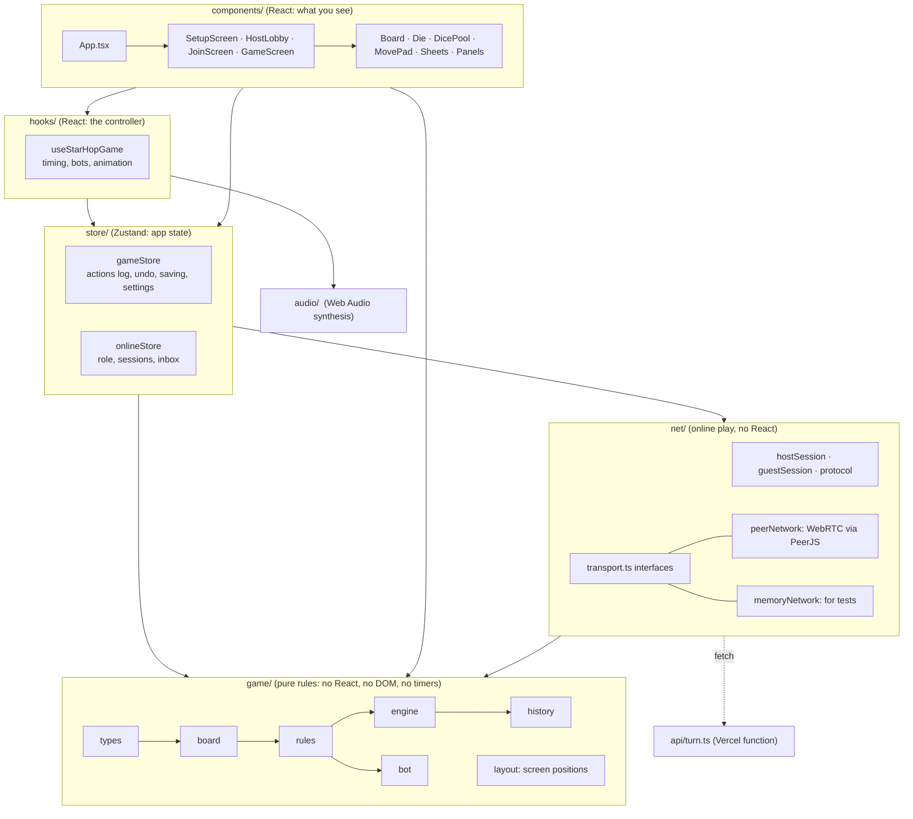
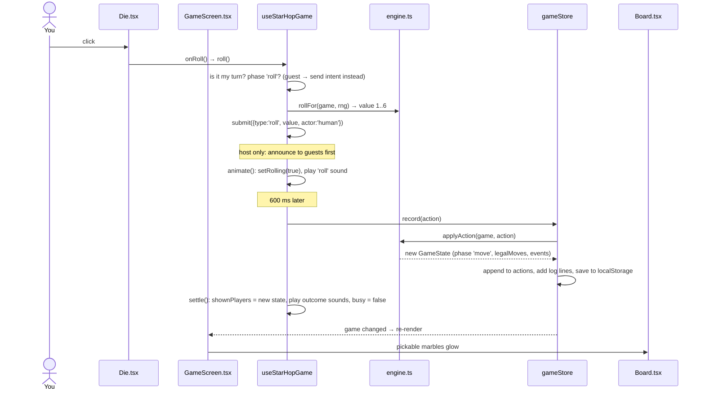

# 6. A tour of the codebase

**Goal:** find anything in the project, explain how the layers fit together, and trace one click from the screen down to the rules and back.

## 6.1 The layers

**The one rule: dependencies point down, towards the rules.** This is checked against the real imports:

| Folder | Imports from |
| --- | --- |
| `game/` | **nothing** outside itself |
| `audio/` | nothing outside itself |
| `net/` | `game/` only |
| `store/` | `game/`, `net/`, `audio/` |
| `hooks/` | `game/`, `net/`, `store/`, `audio/` |
| `components/` | everything above |

Why this matters: the more a folder is depended on, the more stable and well tested it must be, and the fewer things it should know about. `game/` knows nothing about React, browsers or networks, so it can run anywhere (host, guests, bots, tests, a future server) and be tested in milliseconds. This style is called **functional core, imperative shell**: a pure core of logic surrounded by a thin layer that deals with the messy world (timers, clicks, storage, sockets).

## 6.2 Folder by folder

### `src/game/`: the rules (start reading here)

| File | Job | Read it for |
| --- | --- | --- |
| [types.ts](../../src/game/types.ts) | Every domain type: `Spot`, `Marble`, `Player`, `Move`, `GameState`, `GameAction`, `GameEvent` | the vocabulary of the whole project |
| [board.ts](../../src/game/board.ts) | Board geometry as numbers: 84 loop holes, stars, starts, home, "next hole", "steps to home" | how the board graph is numbered |
| [rules.ts](../../src/game/rules.ts) | Move generation: every legal move for a die, with its path | the hardest logic; blocking, star hops, the centre |
| [engine.ts](../../src/game/engine.ts) | State transitions: create a game, roll, move, pass, end, bot takeover | turn flow and the reducer `applyAction` |
| [history.ts](../../src/game/history.ts) | Replay an action list; find where undo goes back to | event sourcing in 40 lines |
| [teams.ts](../../src/game/teams.ts) | Team helpers: teammates, who moves on a helper turn | team play |
| [bot.ts](../../src/game/bot.ts) | Bot personas, move scoring, look-ahead | game AI |
| [describe.ts](../../src/game/describe.ts) | Turns events and moves into English for the log and screen readers | accessibility |
| [layout.ts](../../src/game/layout.ts) | Where each hole is drawn (SVG coordinates). Pure maths; the rules never import it | model vs view |
| [names.ts](../../src/game/names.ts) | Checks setup names: not blank, no duplicates | a small pure function with a clear contract |
| [testUtils.ts](../../src/game/testUtils.ts) | Test helpers: seeded RNG, `place`, `rollAs` | how tests build positions |

### `src/store/`: app state

| File | Job |
| --- | --- |
| [gameStore.ts](../../src/store/gameStore.ts) | The local game: initial state + action list (the source of truth), derived current state and log, undo/redo, pause, settings, saving to `localStorage` with versioned migrations |
| [onlineStore.ts](../../src/store/onlineStore.ts) | Online role (`local`, `host`, `guest`), the current session, incoming messages (the inbox), connecting/errors |

### `src/hooks/`: React glue

| File | Job |
| --- | --- |
| [useStarHopGame.ts](../../src/hooks/useStarHopGame.ts) | **The controller.** Turns clicks into actions, schedules bots and auto-play, animates, records, plays sounds, handles pause |
| [useShortcuts.ts](../../src/hooks/useShortcuts.ts) | Keyboard shortcuts |
| [useOnline.ts](../../src/hooks/useOnline.ts) | Live host/guest session views via `useSyncExternalStore` |
| [useGameClock.ts](../../src/hooks/useGameClock.ts), [useNow.ts](../../src/hooks/useNow.ts), [useMediaQuery.ts](../../src/hooks/useMediaQuery.ts) | Small utilities |

### `src/components/`: what you see

| Group | Files |
| --- | --- |
| Screens | [App.tsx](../../src/App.tsx) (chooses), [SetupScreen](../../src/components/SetupScreen.tsx), [HostLobby](../../src/components/HostLobby.tsx), [JoinScreen](../../src/components/JoinScreen.tsx), [GameScreen](../../src/components/GameScreen.tsx) |
| The board | [Board.tsx](../../src/components/Board.tsx) (SVG), [snap.ts](../../src/components/snap.ts) (nearest-target taps), [colors.ts](../../src/components/colors.ts) |
| Turn controls | [Dice.tsx](../../src/components/Dice.tsx), [DicePool.tsx](../../src/components/DicePool.tsx), [MovePad.tsx](../../src/components/MovePad.tsx), [TeamTurn.tsx](../../src/components/TeamTurn.tsx) |
| Info | [PlayerPanel](../../src/components/PlayerPanel.tsx), [GameLog](../../src/components/GameLog.tsx), [FinishBanner](../../src/components/FinishBanner.tsx), [WinOverlay](../../src/components/WinOverlay.tsx) |
| Overlays | [Sheet.tsx](../../src/components/Sheet.tsx) (bottom sheet on native `<dialog>`), [RulesSheet](../../src/components/RulesSheet.tsx), [SettingsSheet](../../src/components/SettingsSheet.tsx), [GameMenu](../../src/components/GameMenu.tsx), [ConfirmDialog](../../src/components/ConfirmDialog.tsx) |
| Setup helpers | [SeatList](../../src/components/SeatList.tsx), [SeatMap](../../src/components/SeatMap.tsx), [seatArea.ts](../../src/components/seatArea.ts) |

### `src/net/`: online play (chapter 9)

[protocol.ts](../../src/net/protocol.ts) (message types and strict parsing), [hostSession.ts](../../src/net/hostSession.ts), [guestSession.ts](../../src/net/guestSession.ts), [transport.ts](../../src/net/transport.ts) (the interfaces), [peerNetwork.ts](../../src/net/peerNetwork.ts) (real WebRTC), [memoryNetwork.ts](../../src/net/memoryNetwork.ts) (fake network for tests), [invite.ts](../../src/net/invite.ts), [iceServers.ts](../../src/net/iceServers.ts), [nudges.ts](../../src/net/nudges.ts).

### `src/audio/`: sound

[sfx.ts](../../src/audio/sfx.ts) (play a named sound; volume; a limiter), [synth.ts](../../src/audio/synth.ts) (instrument building blocks), [themes.ts](../../src/audio/themes.ts) (Tabla, Classic, Bansuri, Sitar, Santoor). No audio files are shipped. Everything is generated in code.

### Styles

All CSS is in one file, [index.css](../../src/index.css). It starts with **design tokens**: CSS custom properties like `--bg`, `--accent`, `--player-red`, used everywhere else (`color: var(--ink)`). No CSS framework is used.

## 6.3 Trace: what happens when you click the die

This is the most valuable exercise in the guide. Open each file as you read.

Step by step, with the code:

1. **Click.** [Dice.tsx](../../src/components/Dice.tsx) renders a button with `onClick={clickable ? onRoll : undefined}`. [GameScreen.tsx](../../src/components/GameScreen.tsx) passed `onRoll={roll}`, where `roll` came from the controller (`hop.roll`). Pressing Space reaches the same `roll` through `useShortcuts`.
2. **Guard.** `roll` in [useStarHopGame.ts](../../src/hooks/useStarHopGame.ts) checks it's the roll phase and this device's seat. A guest sends an intent to the host instead (chapter 9). Otherwise it calls `performRoll`.
3. **Decide.** `performRoll` checks the busy lock and pause, then calls `rollFor(g, rng, true, target)` from [engine.ts](../../src/game/engine.ts) to get a die value (with comeback odds when a player is stuck). The decision becomes data: `{ type: 'roll', value, actor: 'human' }`.
4. **Submit.** `submit` tells online guests about the action (if hosting), then calls `animate`.
5. **Animate.** For a roll: `setRolling(true)` (the die tumbles), play the roll sound, and schedule the rest for `TIMING.ROLL_MS` (600 ms) later.
6. **Record.** `record(action)` in [gameStore.ts](../../src/store/gameStore.ts) calls `applyAction(game, action)`. If the result is the same object, the action was illegal and is dropped. Otherwise it appends the action to `actions`, adds log lines from the new events, and saves.
7. **Rules.** `applyAction` → `rollWithValue`: adds the die to the pool, asks `legalMovesForPool` (in [rules.ts](../../src/game/rules.ts)) for every legal move, and either moves to phase `'move'` with those moves, or (no moves) passes the turn with a `noMoves` event.
8. **Settle.** `settle()` copies the new state into `shownPlayers`, plays outcome sounds from the events ("oops" for `noMoves`), and releases the busy lock.
9. **Re-render.** Every component that selected `game` from the store re-renders. The board highlights the marbles that can move.
10. **Next.** The controller's scheduler effect runs after the render. If a bot is next, or auto-move applies, it sets a timer and the cycle repeats from step 3, with no click.

Moving a marble follows the same path: `pickMarble` → `playMine` → `performMove` → `submit` → `animate` (walk the path) → `record` → `applyMove` → `settle`.

**Every action takes this one path: decide → announce → animate → record → settle.** Humans, bots, auto-play, undo/redo and online guests all go through it. That's why the game stays consistent.

## 6.4 Where to look when you want to…

| I want to… | Go to |
| --- | --- |
| change a rule | [rules.ts](../../src/game/rules.ts) (what's legal) or [engine.ts](../../src/game/engine.ts) (what happens after), plus [rules.test.ts](../../src/game/rules.test.ts) |
| change how fast things animate | `TIMING` in [useStarHopGame.ts](../../src/hooks/useStarHopGame.ts) |
| change a colour | the tokens at the top of [index.css](../../src/index.css) |
| change board shape or spacing | [layout.ts](../../src/game/layout.ts) |
| change how a bot plays | `PERSONA_WEIGHTS` in [bot.ts](../../src/game/bot.ts) |
| add a setting | `Settings` and `DEFAULT_SETTINGS` in [gameStore.ts](../../src/store/gameStore.ts), then [SettingsSheet.tsx](../../src/components/SettingsSheet.tsx) |
| add a keyboard shortcut | the `useShortcuts({...})` call in [GameScreen.tsx](../../src/components/GameScreen.tsx) |
| change a sound | [themes.ts](../../src/audio/themes.ts) |
| change log or screen-reader text | [describe.ts](../../src/game/describe.ts) |
| change the rules text players read | [RulesSheet.tsx](../../src/components/RulesSheet.tsx) and the README's rules table |
| change what goes over the network | [protocol.ts](../../src/net/protocol.ts) (and bump `PROTOCOL_VERSION`) |
| change what's saved | [gameStore.ts](../../src/store/gameStore.ts) (and bump `SAVE_VERSION` with a migration) |

## 6.5 Project documents and what each is for

| Document | Purpose |
| --- | --- |
| [README.md](../../README.md) | What the game is, how to play, the numbered rules table (R1–R24), architecture summary |
| [PLAN.md](../../PLAN.md) | The original build plan: rule decisions, board numbering, differences from Ludo |
| [LEARNINGS.md](../../LEARNINGS.md) | House rules in precise detail, lessons and pitfalls, hosting costs |
| [docs/](../README.md) | The advanced study guide (after this one) |

The **R-numbers** (R1–R24) in the README are used everywhere: in code comments, in test names (`describe('R2: entering from base', ...)`), in commit messages. When you see "R22", look it up in the README's table.

## Try it

1. Put a `console.log('roll', value)` in `performRoll`, and one in `rollWithValue`. Play a turn and watch the order in the console. Then remove them.
2. Without looking at the diagram, write down the path a bot's move takes from "it's the bot's turn" to the marble arriving. Then check it against the scheduler effect in `useStarHopGame.ts`.
3. Find one place that breaks the "dependencies point down" rule, if any. (Hint: the table above was generated from the real imports.)

## Check yourself

1. Which folder imports nothing from the others, and why is that valuable?
2. What are the five steps every action goes through?
3. Where is an illegal action rejected, and how does the caller know?
4. A designer wants the purple to be lighter. Which file do you open?
5. What does "R22" refer to, and where do you look it up?
