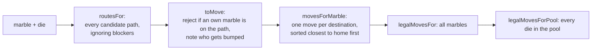

# 7. Walkthrough: the rules core

**Goal:** read `src/game/` line by line and be able to explain how a roll becomes a list of legal moves, and how a move changes the game.

Read the files in this order, with this chapter open beside them: [types.ts](../../src/game/types.ts) → [board.ts](../../src/game/board.ts) → [rules.ts](../../src/game/rules.ts) → [engine.ts](../../src/game/engine.ts) → [history.ts](../../src/game/history.ts). Have the README's rules table (R1–R24) open too.

> Every example in this chapter was checked by running it against the real engine. You can do the same: see "Try it" at the end.

## 7.1 types.ts: the vocabulary

Skim the whole file once. The types to understand properly:

| Type | What it is | Key point |
| --- | --- | --- |
| `Color` | one of six seat colours | a colour's index in `COLORS` is its arm number (red 0 … purple 5) |
| `Spot` | where a marble is: `base`, `loop` (pos 0–83), `center`, `home` (slot 0–3) | a discriminated union (chapter 2) |
| `Marble` | `{ id, spot }` | ids are 0–3 per player |
| `Player` | colour, kind (human/bot), name, marbles, team, rank, last roll, `dryRolls` | `bot` holds the persona for bots |
| `Move` | one legal option: `die`, `marbleId`, `from`, `to`, **`path`**, `via`, `hops`, `bumped`, `reachesHome` | the path is every hole stepped on, ending at `to` |
| `GameState` | everything about a game at one moment | `legalMoves` is precomputed whenever `phase` is `'move'` |
| `GameAction` | a recorded decision: `roll` (with value), `move`, `pass`, `end`, `takeover` | the input to the engine; what's saved and sent online |
| `GameEvent` | what an action caused: `roll`, `move`, `bump`, `finish`, `noMoves`, `gameOver`… | the output, for sounds and the log |
| `HouseRules` | three switches (R22–R24) | stored **in the state**, so replays and guests use the same rules |

Notice the comments. Almost every field explains *why* it exists, not just what it is. Write yours the same way.

## 7.2 board.ts: numbering the board

The board is six arms. The shared loop has **84 holes, 14 per arm**. For arm `a` (red is 0), the holes `14a` to `14a+13` are, in travel order:

| Offset | Hole | Red (arm 0) | Blue (arm 4) |
| --- | --- | --- | --- |
| +0 | star S_a (where arm a−1 meets arm a) | 0 | 56 |
| +1…+5 | inbound column (walking outward) | 1–5 | 57–61 |
| +6 | **pre-start**: this colour's marbles turn into home here | 6 | 62 |
| +7 | **start**: where marbles enter from base | 7 | 63 |
| +8 | post-start | 8 | 64 |
| +9…+13 | outbound column (walking back in) | 9–13 | 65–69 |

So red enters at 7, goes all the way round (8, 9, … 83, 0, 1, … 6), and from 6 steps into home slot 0. The six stars are 0, 14, 28, 42, 56, 70 (`isStar(pos)` is just `pos % 14 === 0`).

Key functions:

- `wrap(pos)`: keeps any number on the loop. `wrap(84)` is 0, `wrap(-1)` is 83. (The double `%` handles negatives: in JavaScript `-1 % 84` is `-1`.)
- `nextWalk(color, spot)`: **the one place the board's shape is defined for walking.** From a loop hole: the next hole, except from your own pre-start, which leads to home slot 0. From home: one slot deeper, or `null` at the end. From base or the centre: `null` (those need special moves).
- `stepsToHome(color, spot)`: how far a marble still has to go. Star hops can carry a marble round and round, so "distance travelled" means nothing. Instead progress is measured as "steps left". Used to order destinations, rank players when a game ends early, and score bot moves.
- `spotKey(color, spot)`: a string that identifies a hole, such as `loop:30`, `center` or `home:red:2`. Home holes include the colour because each player has their own. Used as a `Map` key (objects can't be compared by content, chapter 1).
- `sameSpot(a, b)`: compares two spots by content.

## 7.3 rules.ts: every legal move

This file answers one question: **"With this die, where can each of my marbles go?"** It has no idea whose turn it is; that's the engine's job. The approach is **generate, then filter**:



### `occupancy(players)`

Builds a `Map` from `spotKey` to who is sitting there. Built once per question, then every check is a fast lookup.

### `routesFor(color, marble, dice, rules, blocked)`: the candidate paths

One `case` per kind of spot:

- **base:** on a 1 or a 6, a single-step path to your start. Otherwise nothing.
- **center:** on a 1, six paths, one to each star. Otherwise nothing.
- **home:** walk `dice` steps deeper with `walkPath`, or nothing if that overshoots.
- **loop:** walk `dice` steps. Then, if the last step leaves a star, also offer going into the centre instead (R10). Then, **only if the marble starts on a star**, add the star hops (R8): for each number of hops `h` from 1 to `dice`, hop `h` stars clockwise, then walk the remaining `dice − h` steps down that star's arm.

**Worked example (base rules).** Red has a marble on star 14 and rolls 3. The real output, in display order:

| Badge | Destination | via | Path |
| --- | --- | --- | --- |
| 1 | 56 | hop (3 hops) | 28 → 42 → 56 |
| 2 | 43 | hop (2 hops) | 28 → 42 → 43 |
| 3 | 30 | hop (1 hop) | 28 → 29 → 30 |
| 4 | 17 | walk | 15 → 16 → 17 |

Badge 1 is the one closest to red's home: from hole 56, red needs 35 more steps to reach home, while from 17 it needs 74.

With the **house rule R23 (walk across the centre)** switched on, which is how the live game is played, `networkRoutes` replaces the simple hop loop: from a star the marble may go to the next star, into the centre, or from the centre to any star, without U-turns. The same roll of 3 from star 14 then offers **13 destinations**. `networkRoutes` is a depth-first search with **memoisation**: it remembers each `(hole, previous hole, steps left)` it has already explored, so it stays tiny even though the number of distinct paths runs into thousands. ([Advanced chapter 15](../15-house-rules.md) explains why that memo key is valid.)

### `toMove(...)`: blocking and bumping

Walks the candidate path hole by hole:

- If **your own** marble is on any hole of the path, the route is illegal (R4: never jump or land on your own marble). Return `null`.
- On the **last** hole, anyone else who's there is bumped, unless they're the owner sitting on their own start under the safe-starts house rule (R24).

**Worked example.** Red on 30, blue on 32, red rolls 4. The path is 31 → 32 → 33 → 34. Blue is jumped (allowed), nothing is on 34, so `bumped: null`. Had red rolled 2, the move would land on 32 and bump blue.

### `movesForMarble`: one move per destination, in a fixed order

Several routes can reach the same hole. The function keeps the first one per destination (a `Map` keyed by `spotKey`) and sorts by `stepsToHome`, with the centre always last. **That order is a contract with the UI:** the board numbers destination badges 1, 2, 3 in exactly this order, and keyboard shortcuts 1–9 match. Tests pin it down.

### The rest of the file

- `legalMovesFor` and `legalMovesForPool`: every marble; every distinct die in the pool (R22 can bank several dice).
- `autoMove`: returns the move to play automatically when there's no real choice (one move, or several base marbles that can only all go to start). Used by bots and by the Auto move setting.
- `playersAfterMove`: the players after a move is played: marble moved, bumped marble back to base. Bots use it to look at "the board after this move" without running the whole engine.

## 7.4 engine.ts: turns and consequences

`engine.ts` is a **reducer**: `(state, action) → new state`. Pure: same input, same output, nothing else touched.

### The contract: illegal actions return the same object

```ts
export function rollWithValue(state: GameState, value: number, forColor?: Color): GameState {
  if (state.phase !== 'roll' || !Number.isInteger(value) || value < 1 || value > 6) return state
  ...
```

Every function starts with guard clauses that `return state` unchanged. So every caller checks legality the same way:

```ts
const next = applyAction(state, action)
if (next === state) /* it wasn't legal */
```

The store uses this to keep illegal actions out of history. The online host uses it to ignore a cheating or confused guest. Loading a save uses it to reject a corrupted file. **One rule, enforced in one place.** (Checked: asking the red marble on 30 above to go to 35 with a roll of 4 returns the identical state object.)

### `createGame(configs, rng, rules)`

Validates the setup (2–6 seats, distinct colours, teams all-or-nothing), sorts seats into clockwise arm order (play passes clockwise), works out display names, gives each bot a random persona, puts every marble in base, and picks a random first player (R14). The `rng` parameter is injected so tests can control it.

### `rollWithValue(state, value, forColor?)`

Read it slowly; it's the heart of turn flow.

1. Guard: must be the roll phase and a valid die value.
2. Work out **whose marbles** this roll moves: normally the roller's; in team play, a finished player's chosen teammate (R19).
3. Update `dryRolls` (the comeback dice counter, R13) and `lastRoll`.
4. Add the value to the **pool** of unused dice.
5. House rule R22: if it's a 6, stop here. Stay in the roll phase and bank it.
6. Otherwise ask `legalMovesForPool` for moves.
   - None: emit `noMoves`. After a 6 (without R22) roll again; otherwise `passTurn`.
   - Some: switch to phase `'move'` with `legalMoves` filled in.
7. Every successful path ends with `commit(...)`, which increments `actionSeq` and stores the events.

### `applyMove(state, marbleId, to, die?)`

1. Guard: must be the move phase, and the requested move must be in `legalMoves`. **The engine never trusts the caller to have checked.**
2. Remove the used die from the pool.
3. Move the marble (and send any bumped marble home) with `playersAfterMove`. Emit `move` and maybe `bump` events.
4. If all four of that player's marbles are home: give them a finishing rank, emit `finish` (and `teamFinish` if their whole team is done).
5. If at most one player (or team) is still racing: the game is over. Rank the rest by progress, emit `gameOver`.
6. Otherwise decide what's next: a finishing move ends the turn; dice left in the pool means move again (or lose unusable dice); a 6 earns another roll (R6); else pass the turn.

### `applyAction(state, action)`

The single entry point: a `switch` on `action.type` that calls the functions above. Everything outside the engine (the store, the online host, replays, tests) goes through it.

### Randomness lives at the edge

Notice `applyAction` never rolls a die. A roll *action already contains its value*. The dice are rolled outside the reducer (`rollFor`, using an injected `rng`) and then recorded. That's what keeps the reducer pure and replays exact. Comeback dice (R13) only change the odds in `rollFor`; the recorded value is all a replay needs.

## 7.5 history.ts: event sourcing in 40 lines

```ts
export function replay(initial: GameState, actions: GameAction[]): Replay {
  let state = initial
  const eventsPerAction: GameEvent[][] = []
  for (const action of actions) {
    state = applyAction(state, action)
    eventsPerAction.push(state.events)
  }
  return { state, eventsPerAction }
}
```

That's the whole of event sourcing: fold the actions over the initial state.

`undoIndex(actions)` finds where an undo should go back to: the latest **human** roll, move or pass. Any bot actions after it are removed too, so the human lands back on their own decision. Undoing a move returns you to the same roll (so you can choose differently); undoing again removes the roll.

## 7.6 The supporting cast

- [teams.ts](../../src/game/teams.ts): `moverOf(state)` (whose marbles move this turn), `helperTargets` (which teammates a finished player can roll for), `takesTurns`, `isTeammate`. Small, pure, reused by the engine, bots and UI.
- [bot.ts](../../src/game/bot.ts): `chooseBotMove(state, rng)` scores every legal move with the bot's persona weights. Its "danger" and "attack" features ask **the real move generator** where opponents could land next turn, so star hops and the centre are handled with no separate maths. Results are cached in a `WeakMap` keyed by the immutable `players` array.
- [describe.ts](../../src/game/describe.ts): `describeEvent` turns events into log lines. `destinationLabel` gives each destination an accessible name for screen readers.

## 7.7 How the rules are tested

Open [rules.test.ts](../../src/game/rules.test.ts). Tests are grouped **one `describe` per rule number**, and each test reads like the rule's own example:

```ts
describe('R2: entering from base', () => {
  it('enters start on a 1 or a 6 only', () => { ... })
  it('cannot enter while an own marble is on start', () => { ... })
  it('bumps an opponent sitting on start', () => { ... })
})
```

The helpers in [testUtils.ts](../../src/game/testUtils.ts) make positions easy to set up: `place(game(), 'red', [loop(30)])` puts red's first marble on hole 30; `rollAs(g, 'red', 4)` makes it red's turn and rolls a 4; `destinations(g, 0)` lists where marble 0 can go. Chapter 10 builds on these.

## Try it

1. Copy this into a new file `src/game/scratch.test.ts`, run `npx vitest run src/game/scratch.test.ts`, then delete the file:

   ```ts
   import { expect, it } from 'vitest'
   import { destinations, game, loop, place, rollAs } from './testUtils'

   it('star 14, roll 3', () => {
     const g = rollAs(place(game(), 'red', [loop(14)]), 'red', 3)
     expect(destinations(g, 0)).toEqual([loop(56), loop(43), loop(30), loop(17)])
   })
   ```

2. Change the roll to 1. Predict the destinations first (hint: R10, the centre), then check.
3. Add `{ ...game(), rules: ALL_HOUSE_RULES }` (import it from `./types`) and print `g.legalMoves.length`. Explain why there are 13.
4. In `toMove`, comment out the own-marble check. Run `npx vitest run src/game`. Read which tests fail and why. Undo it.

## Check yourself

1. What are red's start, pre-start and home star holes? Blue's?
2. Why is progress measured as "steps to home" instead of "steps travelled"?
3. Explain "generate, then filter" using `routesFor` and `toMove`.
4. Why is the order of `legalMoves` part of the UI's contract?
5. What does `applyAction` return for an illegal action, and name three callers that rely on it.
6. Why does a roll action carry its value instead of rolling inside the reducer?
