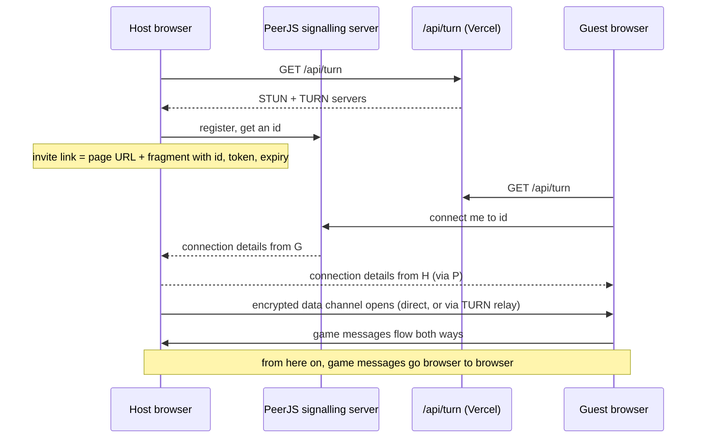
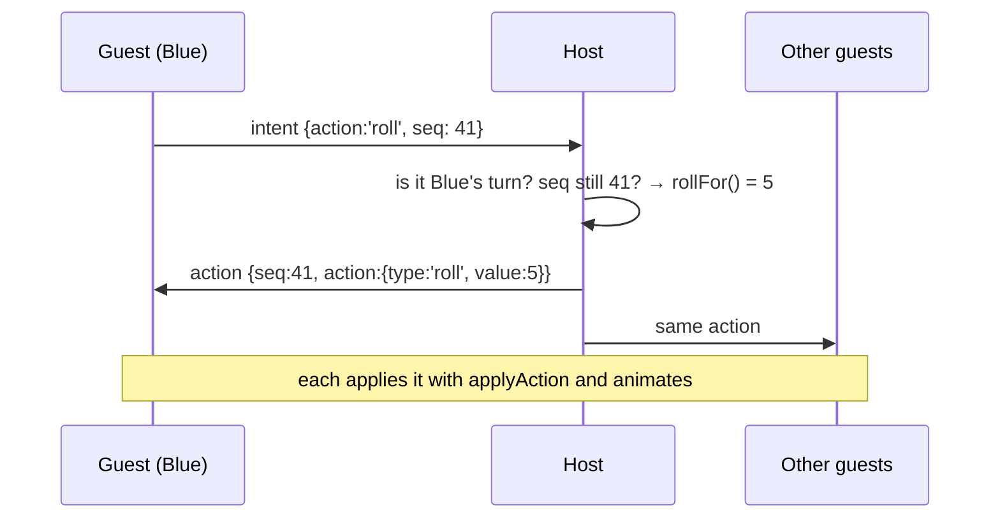

# 9. Walkthrough: online play

**Goal:** explain how two browsers play the same game with no game server, why a guest can't cheat at dice, and how the code is shaped so it can be tested without a network.

Files: [transport.ts](../../src/net/transport.ts), [protocol.ts](../../src/net/protocol.ts), [hostSession.ts](../../src/net/hostSession.ts), [guestSession.ts](../../src/net/guestSession.ts), [peerNetwork.ts](../../src/net/peerNetwork.ts), [memoryNetwork.ts](../../src/net/memoryNetwork.ts), [invite.ts](../../src/net/invite.ts), [iceServers.ts](../../src/net/iceServers.ts), [onlineStore.ts](../../src/store/onlineStore.ts), [api/turn.ts](../../api/turn.ts).

## 9.1 The networking you need, from zero

**Client and server.** Most web apps have browsers (clients) talking to a server the company runs. Star Hop has **no game server**. One player's browser (the **host**) runs the game, and the other players' browsers (**guests**) connect directly to it.

**WebRTC** is the browser technology for direct browser-to-browser connections. It's what video calls use. Star Hop uses its **data channel**: an encrypted pipe for sending messages, not video.

The hard part of WebRTC is that browsers can't simply connect to each other. Most devices sit behind a router doing **NAT** (network address translation): your laptop's address is private, and the router shares one public address among many devices. So connecting needs help:

| Piece | Job | In Star Hop |
| --- | --- | --- |
| **Signalling** | Before connecting, the two browsers must exchange connection details ("here's how to reach me"). Some server has to pass those notes along | The free public **PeerJS** server. It only introduces browsers; game messages never go through it |
| **STUN** | A server that tells a browser its own public address. Enough when the networks are friendly (same Wi-Fi, most home routers) | Google's public STUN servers ([iceServers.ts](../../src/net/iceServers.ts)) |
| **TURN** | A **relay** that forwards the traffic when no direct path exists (phones on mobile data, strict office networks). Costs bandwidth, so providers charge | A free plan from a TURN provider, handed out by `/api/turn` |
| **ICE** | The procedure that tries every option (direct, STUN, TURN) and picks the best path that works | Built into the browser; we just supply the list of STUN/TURN servers |



## 9.2 Host authority: who decides?

If every browser ran its own copy of the game and rolled its own dice, a guest could edit their JavaScript and roll sixes forever. So the design is **host authoritative**:

1. A guest never changes the game. It sends an **intent**: "I'd like to roll", or "move marble 2 to hole 40".
2. The host checks the intent: is it that guest's turn? Is the position current? Is the move legal?
3. The host rolls the die itself, or plays the move, and broadcasts the resulting **action** (with the die value inside) to everyone.
4. Every guest applies the action with the **same engine** and animates it.



This is where event sourcing (chapter 5) pays off: online sync is just "send each new action". A guest that joins late, or reconnects, gets a **snapshot** (initial state + action list) and replays it.

The honest limitation: **the host could cheat**, since its browser rolls the dice. For a game among friends that's acceptable, and the README says so. A server-authoritative design would fix it, at the cost of running servers.

## 9.3 The protocol: messages and the trust boundary

[protocol.ts](../../src/net/protocol.ts) defines every message as a discriminated union on `t`:

- **Guest → host** (`GuestMessage`): `hello` (version, invite token, name, optional seat secret), `intent`, `nudge` (a team suggestion), `resync`, `leave`.
- **Host → guest** (`HostMessage`): `welcome`, `reject`, `lobby`, `sync` (a full snapshot), `action`, `paused`, `nudges`, `ended`.

Every intent carries a `seq`: the number of actions the guest has seen. If the game has moved on by the time it arrives, the host drops it. That stops a double-click, or a slow network, from acting twice.

**Anything from another device is untrusted.** `parseGuestMessage(raw: unknown)` checks every field's type and range (marble id 0–3, die 1–6, strings length-limited, colours from the known list), builds a **fresh object containing only the known fields**, and returns `null` for anything else. Names are cleaned by `sanitizeName`. Only after parsing does the host act, and even then the engine re-checks legality. That's **defence in depth**: two independent checks.

`PROTOCOL_VERSION` (now 3) is sent in `hello`. A guest running an older version of the site is rejected with a clear reason instead of misbehaving.

## 9.4 Ports and adapters: the transport seam

The session code never touches WebRTC directly. It talks to three small interfaces in [transport.ts](../../src/net/transport.ts):

```ts
export interface Channel {                 // a two-way message pipe to one device
  send(message: unknown): void
  close(): void
  onMessage(handler: (message: unknown) => void): void
  onClose(handler: () => void): void
}
export interface HostEndpoint { readonly id: string; onConnect(handler: (channel: Channel) => void): void; close(): void }
export interface Network { host(): Promise<HostEndpoint>; join(hostId: string): Promise<Channel> }
```

Two **adapters** implement them:

| Adapter | Used by | How |
| --- | --- | --- |
| [peerNetwork.ts](../../src/net/peerNetwork.ts) | the real game | wraps PeerJS (loaded with a dynamic `import()` only when needed) |
| [memoryNetwork.ts](../../src/net/memoryNetwork.ts) | the tests | in-memory queues; messages are JSON round-tripped and delivered asynchronously, like a real network |

This pattern is called **ports and adapters** (or hexagonal architecture): the core logic defines the interface it needs (the port), and the outside world plugs in (the adapter). Benefits here:

- [net.test.ts](../../src/net/net.test.ts) and [online.test.ts](../../src/hooks/online.test.ts) test hosts and guests end to end, in milliseconds, with no browser networking.
- Swapping PeerJS for a WebSocket relay later (an option in [LEARNINGS.md §7](../../LEARNINGS.md#7-hosting-online-play-for-free)) means writing one new adapter. Nothing else changes.
- This exact code was reused from the Ludo game unchanged, which is the proof that the abstraction is right ([advanced guide README](../README.md#what-carried-over-from-ludo-and-what-that-proves)).

## 9.5 The sessions

[hostSession.ts](../../src/net/hostSession.ts) and [guestSession.ts](../../src/net/guestSession.ts) are plain TypeScript classes, no React. They expose `subscribe` and `getView`, so React reads them with `useSyncExternalStore` ([useOnline.ts](../../src/hooks/useOnline.ts), chapter 3).

**The host session:**

- creates the invite: a random token and a 5-minute expiry, put in the URL **fragment** (`#join=…&k=…&exp=…`). Browsers never send the fragment to a web server, so the token doesn't end up in any server log;
- on `hello`: checks version, token and expiry, gives the guest the next free online seat and a private **secret**, and replies `welcome` + `sync`;
- lets a guest who dropped out reclaim their seat with that secret, even after the invite has expired;
- drops connections that don't say `hello` within 10 seconds;
- broadcasts every action and keeps the authoritative log;
- passes validated intents to the controller hook through the online store's inbox.

**The guest session:** connects, says hello, stores the seat secret in `sessionStorage` (so a refresh rejoins the same seat), applies actions in order, and asks for a `resync` snapshot if anything doesn't fit.

**In the controller hook** (chapter 8): a guest's UI calls `sendIntent` instead of `performRoll`; the host's scheduler effect picks intents out of the inbox and calls `performRoll` / `performMove`; a guest's effect plays the host's actions one at a time through the same `animate` function as everyone else.

## 9.6 /api/turn: the one piece of server code

TURN relays cost money to run, so providers issue API keys. If the key were in the browser bundle, anyone could take it. [api/turn.ts](../../api/turn.ts) is a Vercel serverless function that:

1. reads the key from server-side environment variables (`TURN_CREDENTIALS_URL`, or static `TURN_URLS`/`TURN_USERNAME`/`TURN_CREDENTIAL`);
2. asks the provider for short-lived relay credentials (with a 4-second timeout);
3. returns `{ iceServers: [...] }`, cached privately in the browser for 5 minutes.

It never throws: if the provider is down, it returns what it has, and play continues with STUN only. The browser validates the response again ([iceServers.ts](../../src/net/iceServers.ts)). The same function runs locally through the Vite plugin in `vite.config.ts` (chapter 4).

What it doesn't protect, as its own comment says: the relay username and password do reach the browser (WebRTC needs them), and anyone can call the endpoint. Rate limiting would go here if abuse ever became a problem.

## 9.7 Cost, in numbers

From [LEARNINGS.md §7](../../LEARNINGS.md#7-hosting-online-play-for-free): a full game sends each guest about 60–100 KB (2 players) up to 0.5–0.75 MB (6 players). Most players never touch the relay. A free 500 MB-a-month relay plan covers a few hundred fully relayed guest-games a month. **Measure before migrating** is the lesson: the "scaling problem" didn't exist.

## Try it

1. Open two windows (one private), host in one and join in the other. In each window's DevTools → Application, look at Local Storage and Session Storage. Which window stores the seat secret, and why there?
2. In [online.test.ts](../../src/hooks/online.test.ts), read "ignores a stale intent" and "plays a guest's legal move intent and ignores an illegal destination". How does each test prove that the host ignored something?
3. In `parseGuestMessage`, temporarily allow `marbleId` up to 9. Which tests catch it? Undo it.
4. Throttle the network in DevTools (Slow 3G) on the guest and double-click roll. Explain why only one roll happens.

## Check yourself

1. What does the PeerJS server do, and what does it *not* do?
2. When is a TURN relay needed, and why does it need a server function?
3. Why does a guest send intents instead of actions?
4. What's the `seq` on an intent for?
5. Describe ports and adapters using `Network`, `peerNetwork` and `memoryNetwork`.
6. Can the host cheat? What would it take to prevent it?
