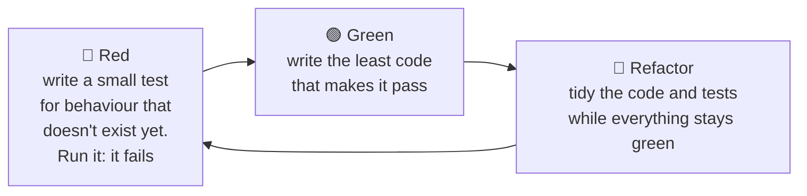

# 10. Testing and test-driven development

**Goal:** read every kind of test in this project, write a test before the code (TDD), and choose the right kind of test for any change.

## 10.1 Why automated tests

A test is a small program that runs your code and checks the result. With 324 of them, you can change something deep in the rules and know within 30 seconds whether you broke anything else. That safety is what lets a team move fast. Without it, every change is a gamble and every refactor is postponed.

Tests also **document behaviour**. `it('cannot enter while an own marble is on start')` is a rule written down in a form that can't go out of date, because the moment it's wrong, it fails.

## 10.2 The tests in this project, by layer

| Layer | Files | About how many | What kind |
| --- | --- | --- | --- |
| Rules core | `src/game/*.test.ts` | 150 | **Unit tests**: call pure functions, check the result. Fast, precise, no browser |
| Full games | [simulation.test.ts](../../src/game/simulation.test.ts) | 5 (thousands of games) | **Property/simulation tests**: seeded bot games, invariants checked after every action |
| Store | [gameStore.test.ts](../../src/store/gameStore.test.ts) | 15 | **Integration**: store + engine + localStorage (jsdom's fake one) |
| Controller | [useStarHopGame.test.ts](../../src/hooks/useStarHopGame.test.ts), [online.test.ts](../../src/hooks/online.test.ts) | 40 | **Integration with fake time**: the hook, store and engine together, timers fast-forwarded |
| Network | `src/net/*.test.ts` | 30 | Protocol parsing, plus host and guest sessions over the in-memory network |
| UI | [App.test.tsx](../../src/App.test.tsx), `src/components/*.test.tsx` | 65 | **Component tests**: render into jsdom, click and type like a user, check what's on screen |
| Server | [api/turn.test.ts](../../api/turn.test.ts) | 4 | The serverless function with a fake `fetch` |
| Audio | [sfx.test.ts](../../src/audio/sfx.test.ts) | 9 | Sound code against a fake audio context |

Most tests sit at the bottom (pure, fast, many) and fewer at the top (slower, broader). That's the classic **test pyramid**. The pure rules core makes it possible: the most important logic is also the easiest to test.

## 10.3 Reading a test: Vitest basics

```ts
import { describe, expect, it } from 'vitest'
import { destinations, game, loop, place, rollAs } from './testUtils'

describe('R3, R4: walking and jumping', () => {            // a group, named after the rule
  it('jumps over opponents', () => {                       // one behaviour
    const g = place(place(game(), 'red', [loop(30)]), 'blue', [loop(32)])   // Arrange
    const rolled = rollAs(g, 'red', 4)                                      // Act
    expect(destinations(rolled, 0)).toEqual([loop(34)])                     // Assert
  })
})
```

**Arrange, act, assert**: set up a position, do one thing, check the outcome. Most tests here follow that shape.

Common matchers:

| Matcher | Checks |
| --- | --- |
| `toBe(x)` | `===`: same primitive value, or the **same object** |
| `toEqual(x)` | same **contents**, deeply (use for objects and arrays) |
| `toMatchObject(x)` | contains at least these fields |
| `toHaveLength(n)` | array or string length |
| `toBeNull()`, `toBeTruthy()` | as named |
| `toBeGreaterThan(n)` | numeric comparison |
| `toBeInTheDocument()` | (UI) the element is on the page. From jest-dom, set up in [setup.ts](../../src/__tests__/setup.ts) |

`expect(next).toBe(state)` is how tests check "this action was ignored": the engine returned the very same object.

## 10.4 The techniques that make this code testable

### Builders for positions

[testUtils.ts](../../src/game/testUtils.ts) lets a test describe a board in one line:

```ts
place(game(['red', 'blue']), 'red', [loop(30), home(2)])   // red marble 0 on hole 30, marble 1 in home slot 2
rollAs(g, 'red', 4)                                         // red's turn, rolls 4
destinations(g, 0)                                          // where can marble 0 go?
```

Good test helpers make tests short enough that the *rule* is what you read, not the setup.

### Controlled randomness

```ts
const dice = (value: number) => () => (value - 1) / 6 + 0.01     // an rng that always rolls `value`
renderHook(() => useStarHopGame(dice(3)))
```

The hook takes `rng` as a parameter (chapter 5), so tests choose the dice. Simulations use `seeded(n)` for reproducible "random" games. [App.test.tsx](../../src/App.test.tsx) goes one level further and replaces `crypto.getRandomValues` with `vi.spyOn`, because the full app uses the real secure generator.

**Pitfall recorded in [LEARNINGS.md](../../LEARNINGS.md):** don't create a scripted rng *inside* the `renderHook` callback (`renderHook(() => useHook(diceSequence(...)))`). That callback runs on every render, so the dice restart each time. Create the rng once, outside.

### Fake timers

The game is full of `setTimeout`. Tests don't wait in real time:

```ts
beforeEach(() => { vi.useFakeTimers() })
afterEach(() => { vi.useRealTimers() })

function advance(ms: number) {
  for (let t = 0; t < ms; t += 50) act(() => vi.advanceTimersByTime(50))
}
```

`vi.advanceTimersByTime` jumps the clock forward and fires any timers due. The helper advances in 50 ms slices, each inside `act()`, so React can re-render and the scheduler effect can queue the next timer. One big jump would skip steps. Tests use the `TIMING` constants, so changing an animation speed doesn't break them.

### Mocking modules

jsdom has no audio. UI and hook tests replace the whole sound module with fakes:

```ts
vi.mock('../audio/sfx', () => ({ playSound: vi.fn(), setMuted: vi.fn(), setVolume: vi.fn(), ... }))
...
expect(playSound).toHaveBeenCalledWith('bump')
```

`vi.fn()` is a **spy**: a function that records how it was called.

### Testing hooks without components

```ts
const { result } = renderHook(() => useStarHopGame(dice(3)))
act(() => result.current.roll())
advance(TIMING.ROLL_MS + 100)
expect(store().actions).toHaveLength(1)
```

`renderHook` (from Testing Library) runs a hook inside a throwaway component. `result.current` is whatever the hook returned on its latest render. `act()` wraps anything that causes React updates.

### Testing UI like a user

```ts
render(<App />)
fireEvent.click(screen.getByRole('radio', { name: '2' }))
fireEvent.click(screen.getByRole('button', { name: 'Start game' }))
expect(screen.getByText(/Pick a marble: press 1–4/)).toBeInTheDocument()
```

Tests find elements **by role and accessible name** (what a screen reader would announce), not by CSS class or test id. That has two payoffs: tests don't break when markup is restyled, and if a test can't find a button by its name, a blind user can't either. Accessibility gets tested for free.

### Fakes at the seams

The in-memory network (chapter 9) and a fake `fetch` passed into `iceServersFromEnv` ([turn.test.ts](../../api/turn.test.ts)) are **fakes**: simple working implementations of an interface. They're possible because the code depends on interfaces and injected functions, not on the real network.

### Invariants over whole games

[simulation.test.ts](../../src/game/simulation.test.ts) plays complete seeded games and, after every action, asserts what must always hold (chapter 5): four marbles each, no illegal sharing, ranks unique, `legalMoves` consistent with the rules, and that replaying the action log reproduces the final state exactly. One test like this explores more positions than hundreds of hand-written ones.

## 10.5 Test-driven development (TDD)

TDD is a working rhythm, not a kind of test:



Why it works:

- **You prove the test can fail.** A test you never saw fail might not be testing anything.
- **You design from the caller's side.** Writing the call first makes you choose a clear name and signature.
- **You stop when it's done.** Green means the behaviour exists. No speculative extras.
- **Refactoring becomes safe**, because you have a net.

This codebase is shaped for it: rules are numbered (R1–R24), and the project's own checklist for a new rule ([LEARNINGS.md §6](../../LEARNINGS.md#6-checklist-for-adding-any-new-rule)) says: write the rule down with its edge cases, then **one test per edge case, written as the rule's own example**, then a seeded simulation with the rule on. The rules tests are literally grouped by rule number.

## 10.6 Worked example: TDD a small real improvement

There's a small duplication in the code. Both [PlayerPanel.tsx](../../src/components/PlayerPanel.tsx) and `describeBoard` in [describe.ts](../../src/game/describe.ts) count home marbles inline:

```ts
const home = player.marbles.filter((m) => m.spot.kind === 'home').length
```

and PlayerPanel shows `${home}/4` with a hard-coded 4 instead of `MARBLES_PER_PLAYER`. Let's add a tested helper, `marblesHome(player)`, test first, then refactor the two callers onto it. Do this for real on a branch: `git switch -c tdd-marbles-home`.

### Step 1, red: write the test first

Add to the end of [engine.test.ts](../../src/game/engine.test.ts), and add `marblesHome` to its existing import from `./engine` (the helpers `game`, `place`, `home`, `loop` and `playerOf` are already imported from `./testUtils`):

```ts
describe('marblesHome', () => {
  it('is 0 at the start of a game', () => {
    expect(marblesHome(playerOf(game(), 'red'))).toBe(0)
  })

  it('counts only marbles in home, not on the loop or in base', () => {
    const g = place(game(), 'red', [home(3), loop(40), home(1)])   // marble 3 stays in base
    expect(marblesHome(playerOf(g, 'red'))).toBe(2)
  })
})
```

Run `npx vitest run src/game/engine.test.ts`. It fails: `marblesHome` doesn't exist (the test runner reports something like `marblesHome is not a function`, and VS Code underlines the import). **That's the red you wanted.**

### Step 2, green: the least code that passes

In [engine.ts](../../src/game/engine.ts), next to `totalProgress`:

```ts
/** How many of a player's marbles are in their home holes. */
export function marblesHome(player: Player): number {
  return player.marbles.filter((m) => m.spot.kind === 'home').length
}
```

Run the test again: green.

### Step 3, refactor: use it, with the net in place

1. In `PlayerPanel.tsx`, import `marblesHome` from `../game/engine` and `MARBLES_PER_PLAYER` from `../game/types`. Replace the inline count with `marblesHome(player)`, and the hard-coded `4` (twice: the title and the `home/4` text) with `MARBLES_PER_PLAYER`.
2. In `describe.ts`, import `marblesHome` from `./engine` and replace the inline count in `describeBoard` with `marblesHome(p)`.
3. Run **all** tests (`npm test`), the type check (`npm run build`) and the linter (`npm run lint`). All green: the refactor changed no behaviour, and the existing UI tests prove it. (This example was run end to end while writing this guide: red with `TypeError: marblesHome is not a function`, then 326 tests green, type check and lint clean.)
4. Commit with a message that says why: "Count home marbles in one tested place".

That's the whole cycle: a failing test, minimal code, then a safe clean-up. Most real TDD steps are this small.

## 10.7 Fixing a bug test-first

When a bug is reported, write the test that **reproduces** it before touching the code:

1. Turn the report into a position: which marbles where, whose turn, which roll. The `place`/`rollAs` helpers make this quick. For a UI bug, use `render(<App />)` and the same clicks the user made.
2. Assert what *should* happen. Run it, **see it fail for the reported reason.**
3. Fix the code. See it pass. Run everything.
4. The test stays forever, so the bug can't come back silently.

If your new test passes straight away, you haven't reproduced the bug yet. Keep narrowing the position until it fails. (A test written to pin down existing behaviour before you change code is called a **characterisation test**. It's useful too, just not proof of a bug.)

## 10.8 Which kind of test for which change?

| You're changing… | Write… |
| --- | --- |
| a rule (what's legal) | unit tests in `rules.test.ts` or `houseRules.test.ts`, one per edge case; then run the simulations |
| turn flow (what happens after) | unit tests in `engine.test.ts` |
| bot behaviour | `bot.test.ts`: a position where the right choice is clear; plus win-rate checks against a random mover |
| saving or migrations | `gameStore.test.ts`: save, reload, upgrade an old save |
| timing or automation | `useStarHopGame.test.ts` with fake timers |
| what's on screen, or keyboard/touch behaviour | a component test with `render` and role queries |
| network messages | `net.test.ts` (parsing) and `online.test.ts` (end to end over the memory network) |
| purely visual styling | no automated test here; check it by eye on a phone and a laptop |

## Try it

1. Do the worked example in 10.6 for real, on a branch.
2. Pick any test in [rules.test.ts](../../src/game/rules.test.ts), break the rule it tests in `rules.ts`, and watch it go red. Then restore it.
3. Install coverage (`npm i -D @vitest/coverage-v8`) and run `npx vitest run --coverage`. Which files are least covered? Is that a problem for those files? (Don't commit the dependency unless you decide to keep it.)
4. Write a test, test first, for this rule from the README: "A 6 earns another roll, even if it allowed no move" (R6). Find out whether one already exists. If it does, compare it with yours.

## Check yourself

1. What are red, green and refactor, and why must you see red first?
2. Why do tests here find buttons by role and name rather than by CSS class?
3. How do tests control dice, and time?
4. What's the difference between `toBe` and `toEqual`? When does the project deliberately use `toBe` on a state?
5. What does a simulation test catch that example tests miss?
6. A bug report says "the centre move isn't offered after a hop". What's your first step?
